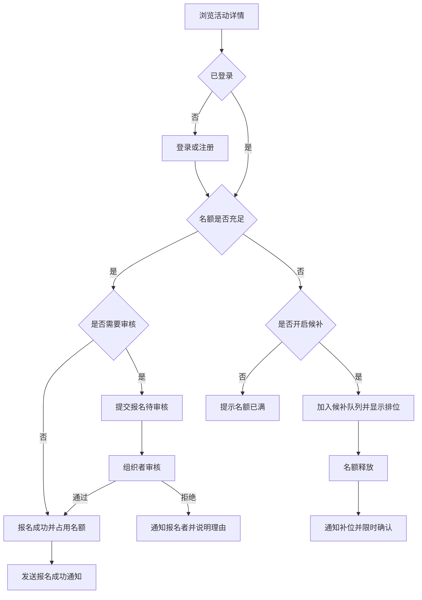
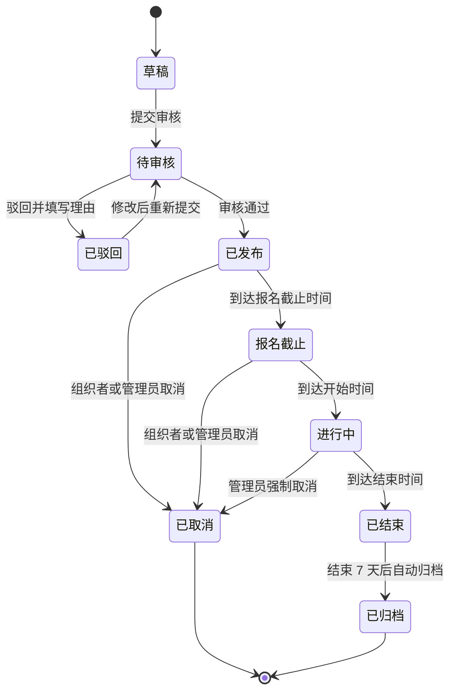
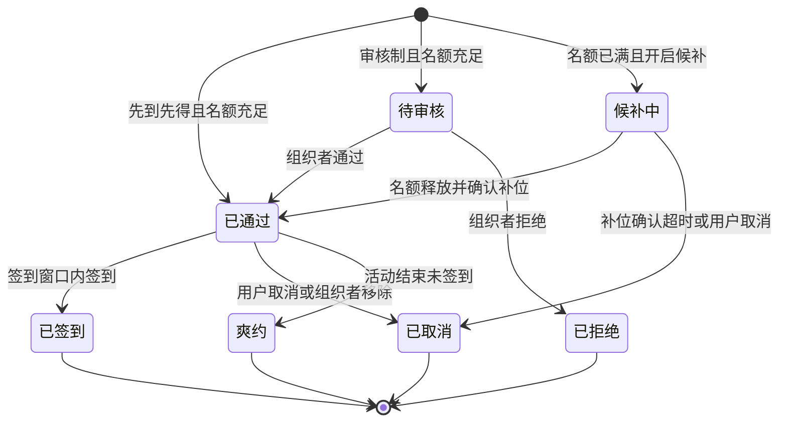
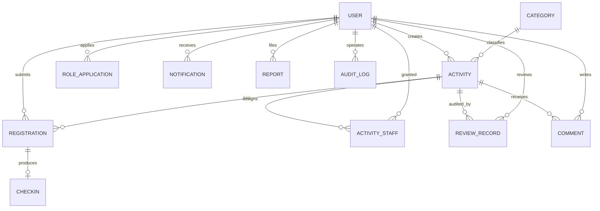

# 活动管理系统需求文档（PRD）

| 项目 | 内容 |
| --- | --- |
| 文档版本 | v1.0 |
| 文档状态 | 待评审 |
| 适用项目 | `test`（实训作业） |
| 编写日期 | 2026-10-22 |
| 需求基线 | 评审通过后冻结，变更走 Issue + PR |
| 关联规范 | [AGENTS.md](../AGENTS.md) |

---

## 0. 文档说明

### 0.1 目的

本文档定义活动管理系统的业务目标、用户角色、功能需求、业务规则、非功能需求与验收标准，作为设计、开发、测试和验收的共同依据。

### 0.2 读者

产品/需求评审人、开发、测试、指导教师，以及后续接手项目的维护者。

### 0.3 编号规则

| 前缀 | 含义 | 示例 |
| --- | --- | --- |
| `US` | 用户故事 | US-01 |
| `FR-<模块>` | 功能需求 | FR-REG-03 |
| `BR` | 业务规则 | BR-06 |
| `NFR` | 非功能需求 | NFR-PERF-02 |
| `AC` | 验收标准 | AC-04 |

### 0.4 优先级

| 优先级 | 含义 | 处理方式 |
| --- | --- | --- |
| P0 | MVP 必须 | 缺失则核心流程不可用，不予验收 |
| P1 | 首个正式版本应包含 | 资源不足时可延后，但需评审确认 |
| P2 | 后续迭代 | 本期只做设计预留，不实现 |

---

## 1. 项目概述

### 1.1 背景

校园社团、院系和内部组织目前主要依赖「群聊通知 + 在线表格接龙」组织活动，存在以下问题：

- 信息分散在多个群和表格中，参与者难以查找、收藏和历史回顾。
- 报名靠人工统计，容易出现重复报名、名额超卖、临时取消无人候补。
- 审核与确认依赖私聊，组织者无法掌握实时名单和审核进度。
- 现场签到靠纸质名单或口头确认，数据无法沉淀，事后统计成本高。
- 活动取消或变更时，通知触达不完整，参与者容易白跑一趟。

### 1.2 产品目标

为组织者提供「发布—审核—报名—签到—统计」的一站式工具，为参与者提供清晰、可信、可追溯的报名体验。

具体目标：

1. 活动发布与报名全流程线上化，替代群接龙和表格。
2. 名额与候补规则由系统强制执行，**不出现超卖**。
3. 签到数据实时可查，活动结束后自动生成签到率等统计。
4. 关键节点（报名结果、活动变更、开始提醒）自动通知，减少人工沟通。
5. 管理端可审核活动、处理举报、追溯操作，满足基本合规要求。

### 1.3 范围与假设

| 编号 | 假设 |
| --- | --- |
| A1 | 平台形态为响应式 Web（PC + 移动浏览器），暂不做原生 App。 |
| A2 | 单组织、单校区部署，统一使用 `Asia/Shanghai` 时区与中文界面。 |
| A3 | 活动以免费为主，MVP 不包含在线支付、退款与发票。 |
| A4 | 规模上限：注册用户 2 万、活动 5000 个、报名记录 50 万条，数据保留 3 年。 |
| A5 | 通知渠道以站内信 + 邮件为主，短信/微信为后续扩展。 |
| A6 | 活动内容由平台审核员审核，报名资格由活动组织者审核。 |
| A7 | 部署在单区域云服务器，数据库使用 PostgreSQL 或 MySQL，缓存使用 Redis。 |

### 1.4 非目标（本期不做）

- 在线支付、退款、发票、票务选座。
- 直播、即时聊天、短视频。
- 原生 iOS/Android App、微信小程序（仅预留 OAuth 接入点）。
- 多租户 SaaS、多组织数据隔离。
- 智能推荐、个性化排序算法。
- 多级审批流、自定义工作流引擎。
- 人脸识别、定位打卡等强隐私采集。

---

## 2. 用户与角色

### 2.1 角色定义

| 角色 | 典型用户 | 核心诉求 | 权限概述 |
| --- | --- | --- | --- |
| 游客 | 未登录访问者 | 浏览公开活动、了解详情 | 只读浏览公开活动，不能报名 |
| 参与者 | 学生、教职工、组织成员 | 找活动、报名、签到、评价 | 报名/取消、查看自己的报名与通知 |
| 组织者 | 社团负责人、院系老师 | 发布活动、管名单、现场签到 | 管理自己发布的活动及其报名、签到、统计 |
| 审核员 | 平台运营/指导教师 | 把控活动内容质量 | 审核活动、查看审核记录与活动详情 |
| 管理员 | 系统负责人 | 维护秩序与系统配置 | 用户/角色/分类/举报/日志/全局配置 |
| 签到员 | 组织者指定的现场同学 | 快速核验到场 | 仅被授权活动的签到核验，无名单编辑权 |

说明：

- 组织者身份需由管理员审批（FR-AUTH-05），普通参与者不能自行发布活动。
- 签到员是组织者在单个活动内授予的临时权限，不改变其全局角色。
- 审核员与管理员可为同一人，但权限模型上分开，便于最小授权。

### 2.2 核心用户旅程

**参与者报名**



**组织者办活动**

1. 创建活动草稿，填写时间、地点、名额与报名方式。
2. 提交平台审核；驳回后按理由修改并重新提交。
3. 审核通过后活动自动上架，参与者可浏览和报名。
4. 在报名截止后处理待审核报名，或直接使用先到先得。
5. 活动现场生成签到码，签到员扫码核验；漏签的补签并备注。
6. 活动结束后查看签到率与报名数据，导出名单归档。

### 2.3 用户故事

| 编号 | 用户故事 | 关联需求 |
| --- | --- | --- |
| US-01 | 作为参与者，我希望按分类和时间筛选活动，以便快速找到感兴趣的活动。 | FR-DISC-01～03 |
| US-02 | 作为参与者，我希望在线完成报名并立即知道结果，以免反复询问组织者。 | FR-REG-02、FR-NOT-01 |
| US-03 | 作为参与者，我希望查看报名状态和电子凭证，以便现场出示。 | FR-REG-09 |
| US-04 | 作为组织者，我希望发布活动前经过平台审核，以保证信息合规。 | FR-ACT-04、FR-ACT-05 |
| US-05 | 作为组织者，我希望审核报名并看到实时名单，以便控制人数。 | FR-REG-05 |
| US-06 | 作为组织者，我希望现场扫码签到并实时看到到场人数，以便掌握进度。 | FR-CHK-01～06 |
| US-07 | 作为组织者，我希望导出报名与签到名单，以便报销和归档。 | FR-REG-10 |
| US-08 | 作为审核员，我希望按提交时间处理活动审核，以便及时上架。 | FR-ADM-01 |
| US-09 | 作为管理员，我希望处理举报并禁用违规账号，以维护平台秩序。 | FR-ADM-02、FR-ADM-04 |
| US-10 | 作为管理员，我希望查询操作日志，以便追溯误操作和违规行为。 | FR-ADM-05 |

---

## 3. 功能需求

### 3.1 模块总览

| 模块 | 编号前缀 | 优先级 | 说明 |
| --- | --- | --- | --- |
| 账号与权限 | FR-AUTH | P0/P1 | 注册登录、个人资料、角色申请 |
| 活动管理 | FR-ACT | P0/P1 | 创建、审核、发布、取消 |
| 活动发现 | FR-DISC | P0/P1 | 列表、搜索、筛选、详情 |
| 报名管理 | FR-REG | P0/P1 | 报名、审核、候补、取消、名单 |
| 签到核验 | FR-CHK | P0/P1 | 签到码、扫码核验、补签、统计 |
| 通知消息 | FR-NOT | P0/P1 | 站内信、邮件、提醒、公告 |
| 评价与反馈 | FR-FBK | P1/P2 | 评价、回复、举报 |
| 统计报表 | FR-RPT | P1/P2 | 单活动数据、平台看板、导出 |
| 后台管理 | FR-ADM | P0/P1 | 审核、用户、分类、举报、日志 |

### 3.2 账号与权限（FR-AUTH）

| 编号 | 需求 | 优先级 |
| --- | --- | --- |
| FR-AUTH-01 | 支持邮箱/用户名 + 密码注册，密码至少 8 位且包含字母和数字，注册时校验邮箱唯一性。 | P0 |
| FR-AUTH-02 | 支持登录、登出；连续 5 次密码错误锁定账号 15 分钟。 | P0 |
| FR-AUTH-03 | 支持忘记密码：邮箱验证码重置，重置链接 30 分钟内有效且仅可使用一次。 | P1 |
| FR-AUTH-04 | 个人资料可编辑昵称、头像、手机号（可选）、所属院系/部门。 | P0 |
| FR-AUTH-05 | 参与者可提交组织者申请（填写理由与联系方式），管理员审批通过后获得发布权限。 | P1 |
| FR-AUTH-06 | 管理员可禁用/启用账号；禁用后现有会话立即失效，登录被拒绝并提示原因。 | P0 |
| FR-AUTH-07 | 支持账号注销：存在进行中报名时不可注销；注销后 30 天冷静期，期满匿名化处理。 | P2 |
| FR-AUTH-08 | 预留统一身份认证（SSO/OAuth）接入点，登录流程可配置。 | P2 |

### 3.3 活动管理（FR-ACT）

| 编号 | 需求 | 优先级 |
| --- | --- | --- |
| FR-ACT-01 | 组织者可创建活动草稿，字段包括标题、分类、封面、简介、详情、地点、开始/结束时间、报名截止时间、名额、报名方式（先到先得/审核制）、是否开启候补、联系人。 | P0 |
| FR-ACT-02 | 保存时按 BR-01、BR-02 校验时间与名额，错误定位到具体字段并给出修改建议。 | P0 |
| FR-ACT-03 | 草稿每 30 秒自动保存，离开页面不丢失。 | P1 |
| FR-ACT-04 | 草稿可提交平台审核，提交后不可直接编辑；审核前可撤回。 | P0 |
| FR-ACT-05 | 审核员可通过或驳回活动；驳回必须填写理由，组织者修改后可重新提交；同一活动连续被驳回 2 次后转管理员复核。 | P0 |
| FR-ACT-06 | 已发布活动的关键字段（时间、地点、名额、报名截止）变更需重新审核，并自动通知已报名者；因变更无法参加者可在活动开始前无条件取消报名。 | P1 |
| FR-ACT-07 | 组织者可取消活动，必须填写原因；系统按 BR-10 批量通知并释放名额。 | P0 |
| FR-ACT-08 | 组织者可复制历史活动生成新草稿（不含报名数据）。 | P2 |
| FR-ACT-09 | 支持封面上传：JPG/PNG/WebP，≤5 MB，支持裁剪为 16:9 或 1:1。 | P1 |
| FR-ACT-10 | 活动详情支持富文本（段落、列表、图片、链接），禁止脚本与内联样式。 | P1 |
| FR-ACT-11 | 管理员可维护活动分类（新增、重命名、排序、停用）；停用分类不影响已发布活动。 | P1 |
| FR-ACT-12 | 支持活动日历视图（按月展示已发布活动）。 | P2 |
| FR-ACT-13 | 支持多场次/分时段报名（如连续三天的系列讲座）。 | P2 |

### 3.4 活动发现（FR-DISC）

| 编号 | 需求 | 优先级 |
| --- | --- | --- |
| FR-DISC-01 | 活动列表按「报名中 / 即将开始 / 已结束」分组展示，分页每页 20 条。 | P0 |
| FR-DISC-02 | 支持按标题和简介关键词搜索，结果高亮关键词。 | P1 |
| FR-DISC-03 | 支持按分类、时间范围、地点、是否仍可报名筛选，可组合使用。 | P1 |
| FR-DISC-04 | 支持按开始时间、发布时间、报名热度排序。 | P1 |
| FR-DISC-05 | 详情页展示活动状态、剩余名额、报名截止倒计时、组织者信息、地址/地图链接，以及随状态变化的报名按钮。 | P0 |
| FR-DISC-06 | 支持复制分享链接；分享页展示活动摘要与报名入口。 | P1 |
| FR-DISC-07 | 支持收藏活动、关注组织者，并在个人中心查看。 | P2 |
| FR-DISC-08 | 仅展示已发布、报名截止、进行中、已结束的公开活动；草稿、待审核、已驳回活动不对普通用户可见。 | P0 |

### 3.5 报名管理（FR-REG）

| 编号 | 需求 | 优先级 |
| --- | --- | --- |
| FR-REG-01 | 报名表单包含内置字段（姓名、手机号、院系、备注）；组织者可追加 1～5 道自定义题（单选/多选/文本）。 | P1 |
| FR-REG-02 | 提交报名时校验：已登录、活动可报名、未重复报名、名额充足、未过截止时间，任一不满足返回明确错误码。 | P0 |
| FR-REG-03 | 先到先得模式下，名额充足即自动通过并占用名额。 | P0 |
| FR-REG-04 | 审核制模式下，报名进入待审核，占用名额但不视为最终通过。 | P0 |
| FR-REG-05 | 组织者可单个或批量审核报名；拒绝必须填写理由，并通知报名者。 | P0 |
| FR-REG-06 | 名额已满且开启候补时，用户可加入候补队列并看到当前排位。 | P1 |
| FR-REG-07 | 名额释放后按候补顺序自动补位；被补位者需在 2 小时内确认，逾期视为放弃并顺延下一位。 | P1 |
| FR-REG-08 | 用户可在活动开始前 24 小时自助取消报名；之后需联系组织者处理。取消后名额按规则释放。 | P0 |
| FR-REG-09 | 「我的报名」按状态筛选展示，并提供含活动信息与签到二维码的电子凭证。 | P0 |
| FR-REG-10 | 组织者可导出本活动报名与签到名单 CSV（含状态、签到时间），导出前二次确认，导出行为写入审计日志。 | P1 |
| FR-REG-11 | 到达报名截止时间，或名额已满且未开启候补时，报名入口关闭并展示原因；开启候补时改为展示「加入候补」入口，名额释放后自动恢复报名。 | P0 |
| FR-REG-12 | 管理员可为用户代报名或批量导入名单（需记录操作人），组织者不可代报名。 | P2 |

### 3.6 签到核验（FR-CHK）

| 编号 | 需求 | 优先级 |
| --- | --- | --- |
| FR-CHK-01 | 组织者可生成签到码：动态 6 位数字（60 秒刷新，用于参与者自助签到）或静态二维码（用于凭证核验），可随时失效重发。 | P0 |
| FR-CHK-02 | 支持两种签到方式：参与者出示电子凭证二维码由签到员扫码核验；或参与者在签到页输入组织者展示的动态 6 位码自助签到。两种方式均返回明确的成功或失败原因。 | P0 |
| FR-CHK-03 | 核验结果需区分：签到成功、重复签到、非本活动、报名未通过、报名已取消、不在签到窗口。 | P0 |
| FR-CHK-04 | 仅签到窗口内允许签到（活动开始前 30 分钟至结束），窗口外提示具体时间。 | P0 |
| FR-CHK-05 | 组织者可在活动结束后 24 小时内手动补签，必须选择报名记录并填写备注，记录操作人。 | P1 |
| FR-CHK-06 | 实时展示已签到人数、签到率与最近签到记录，支持按状态筛选。 | P1 |
| FR-CHK-07 | 弱网/断网时签到页可缓存操作，恢复网络后同步并提示冲突结果。 | P2 |
| FR-CHK-08 | 组织者可在活动内添加或移除签到员（仅限已注册用户）；签到员只能访问核验所需的报名信息。 | P1 |

### 3.7 通知消息（FR-NOT）

| 编号 | 需求 | 优先级 |
| --- | --- | --- |
| FR-NOT-01 | 报名提交、审核结果、活动变更、活动取消、开始提醒等事件生成站内信。 | P0 |
| FR-NOT-02 | 站内信支持未读数、全部已读、按类型筛选、跳转对应活动或报名。 | P0 |
| FR-NOT-03 | 支持邮件通知（用户可关闭），发送失败自动重试 3 次并记录失败原因。 | P1 |
| FR-NOT-04 | 活动开始前 24 小时自动提醒已通过报名的参与者；取消或改期后不再发送旧提醒。 | P1 |
| FR-NOT-05 | 组织者可向本活动报名者群发公告，内容长度 ≤1000 字，发送前预览确认。 | P1 |
| FR-NOT-06 | 支持短信或微信模板消息通道（按用户绑定情况发送）。 | P2 |

### 3.8 评价与反馈（FR-FBK）

| 编号 | 需求 | 优先级 |
| --- | --- | --- |
| FR-FBK-01 | 活动结束后，已签到的参与者可对活动评分（1～5 星）并填写 ≤500 字评价。 | P1 |
| FR-FBK-02 | 评价展示在活动详情页；组织者可回复一次，回复内容对外可见。 | P2 |
| FR-FBK-03 | 用户可举报活动或评价，需选择原因并填写说明；管理员可处理并通知举报人。 | P1 |
| FR-FBK-04 | 评价与举报内容经过敏感词过滤，命中后进入人工复核队列。 | P2 |

### 3.9 统计报表（FR-RPT）

| 编号 | 需求 | 优先级 |
| --- | --- | --- |
| FR-RPT-01 | 单个活动统计：浏览量、报名数、通过数、取消数、候补数、签到数、签到率、爽约数。 | P1 |
| FR-RPT-02 | 平台看板：活动总数、报名总数、日活用户、分类分布、近 30 天趋势。 | P1 |
| FR-RPT-03 | 支持按时间范围导出统计 CSV，导出需管理员权限并记录日志。 | P2 |

### 3.10 后台管理（FR-ADM）

| 编号 | 需求 | 优先级 |
| --- | --- | --- |
| FR-ADM-01 | 活动审核队列按提交时间排序，展示等待时长；支持通过、驳回、查看历史。 | P0 |
| FR-ADM-02 | 用户管理：按昵称/邮箱搜索，查看用户详情，禁用/启用账号，调整角色。 | P0 |
| FR-ADM-03 | 分类管理：新增、重命名、排序、停用，名称唯一。 | P1 |
| FR-ADM-04 | 举报处理：查看举报详情、驳回举报、下架活动或删除评价、通知举报人。 | P1 |
| FR-ADM-05 | 操作日志：记录操作人、时间、动作、对象、IP 与结果，支持按操作人和时间筛选，日志不可编辑。 | P0 |
| FR-ADM-06 | 系统配置：默认签到窗口、报名截止提醒、通知开关、爽约限制参数。 | P2 |
| FR-ADM-07 | 管理员可手动触发数据导出与备份检查。 | P2 |
| FR-ADM-08 | 高风险操作（取消活动、禁用用户、调整角色）需二次确认并填写原因。 | P1 |

### 3.11 权限矩阵

| 操作 | 游客 | 参与者 | 组织者 | 审核员 | 管理员 |
| --- | --- | --- | --- | --- | --- |
| 浏览公开活动 | ✓ | ✓ | ✓ | ✓ | ✓ |
| 报名/取消自己的报名 | — | ✓ | 仅非本人活动 | ✓ | ✓ |
| 创建活动 | — | — | ✓ | — | ✓ |
| 编辑/取消活动 | — | — | 仅自己活动 | — | 任意活动 |
| 查看/审核报名名单 | — | — | 仅自己活动 | — | 任意活动 |
| 签到核验/补签 | — | — | 仅自己活动 | — | ✓ |
| 审核活动 | — | — | — | ✓ | ✓ |
| 处理举报 | — | — | — | — | ✓ |
| 用户与角色管理 | — | — | — | — | ✓ |
| 系统配置/审计日志 | — | — | — | — | ✓ |

说明：签到员不具备全局角色，由组织者在单个活动内授权，仅可执行签到核验，不能查看完整名单或导出数据。

---

## 4. 业务规则

| 编号 | 规则 | 边界与说明 |
| --- | --- | --- |
| BR-01 | 活动结束时间必须晚于开始时间；报名截止时间必须早于开始时间；开始时间须晚于当前时间。 | 修改关键时间需重新审核（FR-ACT-06） |
| BR-02 | 名额 `capacity ≥ 1`；已通过报名与待审核报名均占用名额，候补不占用。 | 名额变更不得低于已通过人数与待审核人数之和 |
| BR-03 | 仅「已发布」状态且未到报名截止时间可报名；到达截止时间即关闭入口。 | 截止时间边界为「小于」，等于截止时间不可报名 |
| BR-04 | 同一用户对同一活动最多保留一条有效报名（已取消记录不占用）。 | 数据库唯一索引兜底 |
| BR-05 | 审核制报名由组织者在报名截止后 24 小时内处理；逾期系统自动拒绝并通知。 | 自动拒绝理由统一为「组织者未在时限内处理」 |
| BR-06 | 名额释放后按候补入队顺序补位，被补位者需在 2 小时内确认，逾期释放并顺延。 | 补位通知发站内信；开启邮件的用户同时收到邮件 |
| BR-07 | 用户可在活动开始前 24 小时自助取消；之后只能由组织者移除并填写原因。 | 活动开始后不可取消；活动开始前因活动变更取消不受 24 小时限制 |
| BR-08 | 组织者不得报名自己发布的活动。 | 避免名单与审核权限冲突 |
| BR-09 | 活动结束仍未签到且未取消的报名记为爽约；30 天内累计 3 次爽约，限制报名 30 天。 | P2，参数可在后台配置 |
| BR-10 | 组织者可在活动开始前取消活动；管理员可在任意阶段强制取消。取消必须填写原因，系统批量通知并释放名额。 | 已开始的活动仅管理员可取消 |
| BR-11 | 签到窗口为活动开始前 30 分钟至结束；补签仅限结束后 24 小时内且必须备注。 | 窗口参数可由管理员配置 |
| BR-12 | 活动提交审核后 24 小时内应处理；驳回必须填写理由，同一活动连续驳回 2 次需管理员复核。 | 超时提醒审核员与管理员 |
| BR-13 | 报名名单仅活动组织者、签到员（仅核验所需字段）与管理员可见；列表中的手机号脱敏展示。 | 导出需二次确认并记日志 |
| BR-14 | 所有时间以 `Asia/Shanghai` 展示与校验；数据库以 UTC 存储。 | 跨时区用户统一按平台时区 |

---

## 5. 状态机

### 5.1 活动状态



### 5.2 报名状态



状态约束：

- 仅「已通过」的报名可签到；候补、待审核、已拒绝不可签到。
- 「已签到」为终态，不允许再取消或改为爽约。
- 活动取消时，其下所有非终态报名统一转为「已取消」并通知。

---

## 6. 非功能需求

### 6.1 性能与容量

- **NFR-PERF-01** 活动列表接口 P95 ≤ 500 ms，活动详情 P95 ≤ 300 ms，报名接口 P95 ≤ 800 ms（不含邮件发送耗时）。
- **NFR-PERF-02** 移动端 4G 网络下首屏 LCP ≤ 2.5 s，可交互时间 ≤ 3.5 s。
- **NFR-PERF-03** 支持峰值 200 QPS、500 用户并发报名；压测下**不出现超卖**、不产生重复报名。
- **NFR-PERF-04** 容量上限：2 万用户、5000 活动、50 万报名记录；列表接口禁止全表扫描，必须命中索引。
- **NFR-PERF-05** 邮件、通知等异步任务与报名主流程解耦，通知失败不回滚报名。

### 6.2 可用性与备份

- **NFR-AVAIL-01** 月度可用性 ≥ 99.5%；计划维护需提前 24 小时公告。
- **NFR-AVAIL-02** 每日全量备份 + 增量日志备份，RPO ≤ 24 小时，RTO ≤ 4 小时；每季度做一次恢复演练。
- **NFR-AVAIL-03** 通知、统计等非核心功能故障时，报名与签到主流程可降级运行。

### 6.3 安全

- **NFR-SEC-01** 全站 HTTPS（TLS 1.2+），启用 HSTS；禁止在 URL 中传递敏感参数。
- **NFR-SEC-02** 密码使用 Argon2id（或 bcrypt，cost ≥ 12）加盐哈希存储，禁止明文或可逆加密。
- **NFR-SEC-03** 防 SQL 注入（参数化查询）、XSS（输出转义 + CSP）、CSRF（SameSite + Token）、越权（服务端逐请求校验资源归属）。
- **NFR-SEC-04** 登录失败 5 次锁定 15 分钟；验证码与重置令牌一次性使用，30 分钟过期。
- **NFR-SEC-05** 上传文件校验类型、大小并重命名，图片二次渲染去除潜在脚本；上传目录禁止执行。
- **NFR-SEC-06** 报名、签到、登录接口限流：单用户 10 次/分钟，单 IP 100 次/分钟，超限返回 429。
- **NFR-SEC-07** 审计日志追加写入、不可编辑，保留 ≥180 天，覆盖登录、审核、导出、取消、角色变更等操作。
- **NFR-SEC-08** 依赖漏洞扫描纳入 CI，高危漏洞需在 7 天内修复。

### 6.4 隐私与合规

- **NFR-PRIV-01** 遵循最小必要原则，手机号等字段可选填；收集前明确告知用途。
- **NFR-PRIV-02** 名单、手机号在非必要场景脱敏展示（如 `138****1234`）。
- **NFR-PRIV-03** 导出报名数据需组织者/管理员权限，记录导出人、时间、范围，文件不长期留存。
- **NFR-PRIV-04** 用户可申请注销；30 天冷静期后匿名化，统计数据保留但不含个人标识。
- **NFR-PRIV-05** 不向第三方共享个人信息；邮件服务商仅传输发送所需的最少字段。
- **NFR-PRIV-06** 符合《个人信息保护法》的告知—同意要求，隐私政策在注册页可查。

### 6.5 兼容性与适配

- **NFR-COMPAT-01** 支持 Chrome、Edge、Firefox、Safari 最近两个大版本。
- **NFR-COMPAT-02** 支持 iOS 15+、Android 10+ 的移动浏览器；关键页面适配 375～1920 px。
- **NFR-COMPAT-03** 签到页在弱网下可加载，二维码可截图保存到相册。

### 6.6 可维护性与可观测性

- **NFR-MAINT-01** 前后端分离，接口统一 `/api/v1` 前缀并维护 OpenAPI 文档。
- **NFR-MAINT-02** 配置与密钥通过环境变量注入，禁止写入仓库；数据库变更使用版本化迁移脚本。
- **NFR-MAINT-03** 结构化日志包含 `request_id`、用户 ID、耗时与结果；核心模块单元测试覆盖率 ≥60%。
- **NFR-MAINT-04** 监控请求量、错误率、P95 延迟、报名成功率、签到成功率；5xx 持续 5 分钟超过 1% 触发告警。
- **NFR-MAINT-05** 应用日志保留 30 天，审计日志保留 180 天，备份保留 30 天。

### 6.7 可访问性

- **NFR-A11Y-01** 关键页面支持键盘操作，表单控件有关联 label，图片有 alt 文本。
- **NFR-A11Y-02** 正文文字对比度 ≥ 4.5:1，状态不能仅用颜色区分。

---

## 7. 数据模型

### 7.1 实体清单

| 实体 | 说明 | 关键字段 |
| --- | --- | --- |
| User | 用户账号 | id、email（唯一）、password_hash、nickname、phone、role、status、last_active_at、created_at |
| Category | 活动分类 | id、name（唯一）、sort、enabled |
| Activity | 活动 | id、organizer_id、category_id、title、summary、description、cover_url、location、contact_name、contact_phone、start_at、end_at、registration_deadline、capacity、reserved_count、registration_mode、waitlist_enabled、status、cancel_reason、view_count、published_at、version、created_at、updated_at |
| ActivityStaff | 活动内授权 | id、activity_id、user_id、permission、granted_by、created_at |
| RoleApplication | 组织者申请 | id、user_id、reason、status、reviewed_by、reviewed_at、created_at |
| SystemConfig | 系统配置 | key（唯一）、value、updated_by、updated_at |
| Registration | 报名记录 | id、activity_id、user_id、status、form_data、waitlist_position、waitlist_notified_at、waitlist_expires_at、created_at、reviewed_by、reviewed_at、cancelled_at、cancel_reason |
| CheckIn | 签到记录 | id、registration_id（唯一）、method（QR/CODE/MANUAL）、operator_id、checked_in_at、remark |
| ReviewRecord | 活动审核记录 | id、activity_id、reviewer_id、result、comment、created_at |
| Notification | 站内信 | id、user_id、type、title、content、link、read_at、created_at |
| Comment | 评价 | id、activity_id、user_id、rating、content、status、reply、created_at |
| Report | 举报 | id、reporter_id、target_type、target_id、reason、status、handled_by、handled_at |
| AuditLog | 审计日志 | id、actor_id、action、target_type、target_id、detail、ip、created_at |

### 7.2 ER 图



### 7.3 关键约束

- `Registration(activity_id, user_id)` 在「非取消」状态下唯一，数据库使用部分唯一索引兜底；MySQL 可用生成列模拟部分索引。
- `Activity.reserved_count` 缓存「已通过 + 待审核」人数，名额扣减必须在事务中原子完成（`UPDATE ... SET reserved_count = reserved_count + 1 WHERE id = ? AND reserved_count < capacity`），禁止「先查后写」。
- `CheckIn.registration_id` 唯一，重复签到返回冲突而非新增记录。
- `Activity.capacity` 不得小于 `reserved_count`；`end_at > start_at`、`registration_deadline < start_at` 使用数据库 CHECK 约束。
- `ActivityStaff(activity_id, user_id)` 唯一，权限仅允许 `checkin`；活动结束或移除后立即失效。
- 所有时间字段以 UTC 存储，接口返回 ISO 8601 格式，前端按 `Asia/Shanghai` 展示。
- 用户与活动使用软删除；报名、签到、审计日志只追加不物理删除。
- 活动更新使用乐观锁（`version`），避免组织者与审核员并发修改覆盖。

---

## 8. 接口草案（参考）

统一约定：JSON 传输；除登录注册外需 `Authorization: Bearer <token>`；分页参数 `page`、`page_size`（默认 20）；错误响应包含 `code`、`message`、`request_id`。

| 方法 | 路径 | 说明 | 权限 |
| --- | --- | --- | --- |
| POST | `/api/v1/auth/register` | 注册 | 公开 |
| POST | `/api/v1/auth/login` | 登录 | 公开 |
| POST | `/api/v1/auth/logout` | 登出 | 登录用户 |
| POST | `/api/v1/role-applications` | 提交组织者申请 | 登录用户 |
| POST | `/api/v1/admin/role-applications/{id}/review` | 审批组织者申请 | 管理员 |
| GET | `/api/v1/activities` | 活动列表/搜索 | 公开 |
| GET | `/api/v1/activities/{id}` | 活动详情 | 公开 |
| POST | `/api/v1/activities` | 创建活动草稿 | 组织者/管理员 |
| PATCH | `/api/v1/activities/{id}` | 编辑活动 | 活动组织者/管理员 |
| POST | `/api/v1/activities/{id}/submit` | 提交审核 | 活动组织者 |
| POST | `/api/v1/activities/{id}/review` | 审核通过/驳回 | 审核员/管理员 |
| POST | `/api/v1/activities/{id}/cancel` | 取消活动 | 组织者/管理员 |
| POST | `/api/v1/activities/{id}/registrations` | 报名 | 登录用户 |
| GET | `/api/v1/registrations/mine` | 我的报名 | 登录用户 |
| POST | `/api/v1/registrations/{id}/review` | 审核报名 | 活动组织者/管理员 |
| DELETE | `/api/v1/registrations/{id}` | 取消报名 | 报名者本人/组织者 |
| GET | `/api/v1/activities/{id}/registrations` | 报名名单 | 活动组织者/管理员 |
| GET | `/api/v1/activities/{id}/registrations/export` | 导出报名与签到名单 | 活动组织者/管理员 |
| POST | `/api/v1/activities/{id}/checkin-code` | 生成签到码 | 活动组织者 |
| POST | `/api/v1/activities/{id}/staff` | 添加签到员 | 活动组织者 |
| DELETE | `/api/v1/activities/{id}/staff/{user_id}` | 移除签到员 | 活动组织者 |
| POST | `/api/v1/checkins` | 扫码/签到码核验 | 签到员/组织者 |
| GET | `/api/v1/notifications` | 站内信列表 | 登录用户 |
| POST | `/api/v1/reports` | 举报 | 登录用户 |
| GET | `/api/v1/admin/audit-logs` | 审计日志 | 管理员 |

错误示例：

```json
{
  "code": "REGISTRATION_FULL",
  "message": "名额已满，可加入候补",
  "request_id": "req_01HZX8..."
}
```

---

## 9. 页面与信息架构

| 端 | 页面 | 主要内容 |
| --- | --- | --- |
| 前台 | 首页/活动列表 | 搜索、筛选、分组、分页、活动卡片 |
| 前台 | 活动详情 | 活动信息、剩余名额、倒计时、报名按钮、评价 |
| 前台 | 登录/注册/找回密码 | 表单校验、错误提示、隐私政策入口 |
| 前台 | 个人中心-我的报名 | 状态筛选、电子凭证、取消报名 |
| 前台 | 个人中心-通知 | 未读数、类型筛选、跳转 |
| 前台 | 个人中心-资料 | 头像、昵称、手机号、院系、组织者申请 |
| 组织者 | 工作台-活动管理 | 草稿/审核中/已发布/已结束列表 |
| 组织者 | 活动编辑 | 分步表单、自动保存、预览 |
| 组织者 | 报名管理 | 名单、审核、候补、导出 |
| 组织者 | 签到核验 | 签到码、扫码、实时统计、补签 |
| 组织者 | 活动统计 | 报名/签到/取消/候补数据 |
| 管理端 | 审核队列 | 待审核列表、详情、通过/驳回 |
| 管理端 | 用户管理 | 搜索、详情、禁用、角色调整 |
| 管理端 | 分类管理 | 增删改、排序、停用 |
| 管理端 | 举报处理 | 举报列表、处理、通知 |
| 管理端 | 数据看板 | 平台指标与趋势 |
| 管理端 | 操作日志 | 筛选、详情 |

---

## 10. 验收标准

### AC-01 活动发布

- **Given** 组织者已登录且拥有发布权限
- **When** 填写完整活动信息并提交审核，审核员通过
- **Then** 活动状态变为「已发布」，出现在活动列表，其他用户可查看详情并报名；审核记录包含审核人与时间。

### AC-02 先到先得与满员

- **Given** 活动为先到先得，名额 1，尚无报名
- **When** 用户 A 报名成功，用户 B 再次报名
- **Then** A 获得「已通过」和电子凭证；B 收到「名额已满」提示，若开启候补则可加入候补并看到排位 1。

### AC-03 候补自动补位

- **Given** 活动满员，候补队列中有 B（排位 1）、C（排位 2）
- **When** A 取消报名
- **Then** B 收到补位通知并需在 2 小时内确认；确认后状态变为「已通过」；若 B 逾期未确认，则名额顺延给 C。

### AC-04 审核制报名

- **Given** 活动为审核制，名额 10，有 3 条待审核报名
- **When** 组织者拒绝其中 1 人，且报名截止后 24 小时仍未处理剩余 2 人
- **Then** 被拒绝者收到含理由的通知；超时未处理的 2 人自动变为「已拒绝」并收到通知；名额占用数同步释放。

### AC-05 签到核验

- **Given** 活动正在进行，签到窗口开放，动态签到码有效
- **When** 签到员扫描已通过报名者的凭证，或参与者在签到页输入当前 6 位签到码
- **Then** 首次核验成功并记录签到时间与操作人；同一报名再次核验提示「重复签到」；未通过审核、已取消或已过窗口的报名提示对应失败原因。

### AC-06 活动取消

- **Given** 活动已有 20 人报名
- **When** 组织者填写原因并取消活动
- **Then** 活动状态变为「已取消」，20 人全部收到站内信，开启邮件通知的用户同时收到邮件；报名状态转为「已取消」，名额与候补队列清空，详情页展示取消原因。

### AC-07 权限隔离

- **Given** 组织者 A 与组织者 B 各有一个活动
- **When** A 尝试通过接口编辑 B 的活动、查看 B 的报名名单或导出数据
- **Then** 服务端返回 403，且审计日志记录该越权尝试；前端不展示对应入口。

### AC-08 并发不超卖

- **Given** 活动名额 100，当前已通过 0 人
- **When** 500 个用户并发报名（先到先得）
- **Then** 恰好 100 人报名成功，其余返回「名额已满」；数据库无重复报名记录，报名总数与名额一致。

### 上线前检查清单

- [ ] P0 需求全部实现并通过 AC-01～AC-08
- [ ] 报名、签到、审核主流程在移动端完成一次真实演练
- [ ] 压测报告显示无超卖、无重复报名，P95 达标
- [ ] 权限矩阵逐项验证，越权请求全部被拒绝
- [ ] 隐私政策、用户协议、注销入口可用
- [ ] 备份恢复演练通过，监控告警可触达负责人
- [ ] 审计日志覆盖登录、审核、导出、取消、角色变更

---

## 11. 成功指标

| 指标 | 目标值 | 统计口径 |
| --- | --- | --- |
| 报名成功率 | ≥ 99.5% | 有名额时的成功报名 / 有效报名请求 |
| 报名接口错误率 | ≤ 0.5% | 5xx 或超时 / 报名请求；名额已满等预期结果不计入 |
| 签到率 | ≥ 75% | 已签到 / 已通过报名（试点活动） |
| 活动审核中位时长 | ≤ 12 小时 | 提交审核 → 审核完成 |
| 活动详情 P95 | ≤ 300 ms | 服务端处理时间 |
| 首屏 LCP | ≤ 2.5 s | 4G 中端机，活动列表页 |
| 线上 5xx 率 | ≤ 0.1% | 全站请求 |
| 活动报名覆盖率 | ≥ 40% | 有报名活动数 / 已发布活动数（试点期） |

---

## 12. 里程碑与交付物

按 6～7 周实训排期，可按实际情况压缩或并行。

| 阶段 | 周期 | 交付物 | 退出标准 |
| --- | --- | --- | --- |
| M0 需求与设计 | 第 1 周 | 本文档、页面原型、ER 图、接口草案 | 需求评审通过，范围冻结 |
| M1 工程基础 | 第 1～2 周 | 项目骨架、CI、登录注册、权限中间件 | 注册—登录—登出闭环可用 |
| M2 活动与审核 | 第 2～3 周 | 活动 CRUD、分类、审核队列 | 活动可创建、审核、上架 |
| M3 报名与候补 | 第 3～4 周 | 报名、审核、候补、名单导出 | AC-02、AC-03、AC-04 通过 |
| M4 签到与通知 | 第 5 周 | 签到码、扫码核验、站内信、邮件 | 现场签到演练通过 |
| M5 统计与后台 | 第 5～6 周 | 数据看板、举报、审计日志、系统配置 | 管理端主流程可用 |
| M6 测试与验收 | 第 6～7 周 | 测试报告、压测报告、演示环境 | AC-01～AC-08 全部通过 |

---

## 13. 风险与应对

| 风险 | 影响 | 应对措施 |
| --- | --- | --- |
| 并发报名超卖 | 名单失真、现场冲突 | 事务 + 原子扣减 + 唯一索引，上线前压测 |
| 审核积压 | 活动无法及时上架 | 队列按等待时长排序、超时提醒、支持批量审核 |
| 签到码被截图转发 | 代签、数据失真 | 动态码 60 秒刷新、凭证短时效、补签留痕 |
| 邮件送达率低 | 用户错过变更 | 站内信兜底、失败重试、关键变更详情页强提示 |
| 需求蔓延 | 延期、核心流程做不完 | MVP 范围冻结，新增需求走 Issue 并重新排期 |
| 隐私数据泄露 | 合规风险、信任受损 | 最小权限、脱敏、导出审计、定期权限复核 |
| 单点故障 | 服务不可用 | 每日备份、监控告警、非核心功能降级 |

---

## 14. 开放问题

| 编号 | 问题 | 影响 | 建议默认值 | 状态 |
| --- | --- | --- | --- | --- |
| Q1 | 是否需要微信小程序/公众号入口？ | 端形态、登录体系、开发成本 | MVP 仅 Web，预留 OAuth | 待确认 |
| Q2 | 是否支持付费活动与退款？ | 支付、对账、退款流程 | 本期不支持 | 待确认 |
| Q3 | 是否需要多组织/多校区数据隔离？ | 数据模型与权限复杂度 | 单组织部署 | 待确认 |
| Q4 | 是否接入学校统一身份认证？ | 登录流程与账号体系 | 预留 SSO 接口 | 待确认 |
| Q5 | 是否需要多场次/分时段报名？ | 报名模型与签到逻辑 | 二期实现 | 待确认 |
| Q6 | 通知渠道优先级？ | 触达率与成本 | 站内信 + 邮件 | 待确认 |
| Q7 | 数据保留期限与注销策略？ | 合规与存储成本 | 保留 3 年，注销冷静期 30 天 | 待确认 |
| Q8 | 是否需要定位签到或人脸识别？ | 隐私风险与实现成本 | 不做，采用动态码 | 待确认 |

---

## 附录 A：术语表

| 术语 | 说明 |
| --- | --- |
| 活动 | 由组织者创建、经平台审核后发布的活动，可包含一个或多个场次 |
| 报名 | 用户对某个活动提交的参与申请，包含状态流转 |
| 审核制 | 报名后需组织者人工确认才能通过的模式 |
| 先到先得 | 名额充足时报名即通过的模式 |
| 候补 | 名额已满后排队等待补位的机制 |
| 签到窗口 | 允许签到的时间范围，默认为开始前 30 分钟至结束 |
| 爽约 | 报名通过但活动结束仍未签到的行为 |
| 组织者 | 拥有活动创建与管理权限的用户 |
| 签到员 | 被组织者授权在单个活动内执行签到核验的用户 |
| RBAC | 基于角色的访问控制 |
| MVP | 最小可行产品，本文档中对应 P0 需求集合 |
| 基线 | 评审通过后冻结的需求版本，变更需走流程 |

## 附录 B：变更记录

| 版本 | 日期 | 变更内容 | 作者 |
| --- | --- | --- | --- |
| v1.0 | 2026-10-22 | 初稿：角色、功能需求、业务规则、状态机、非功能需求、验收标准 | 待填写 |
